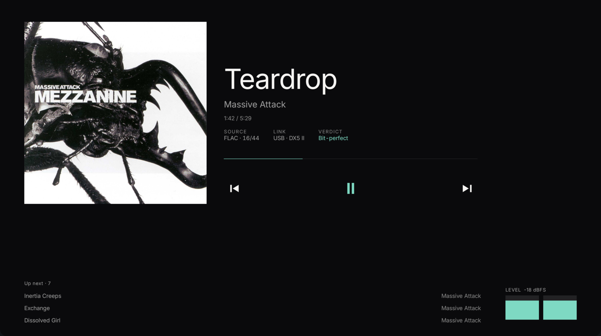
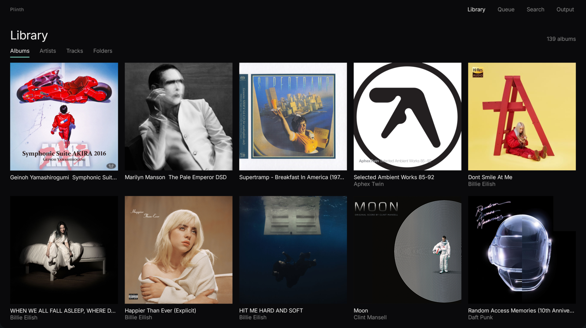
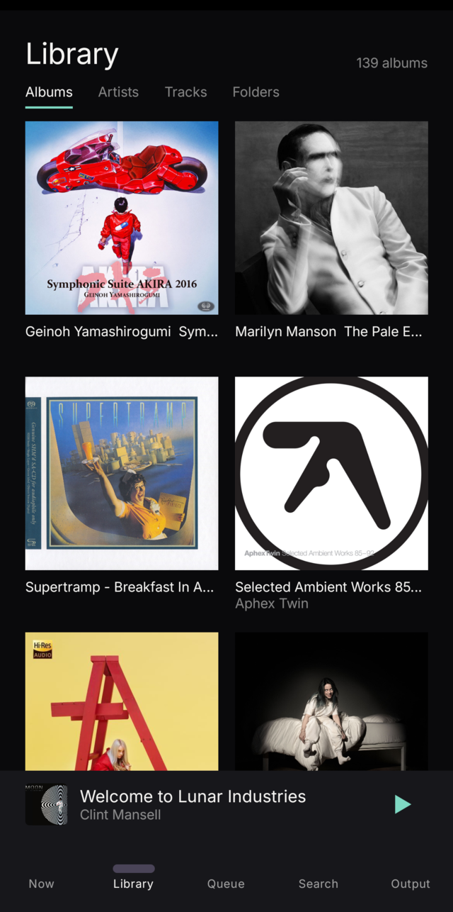
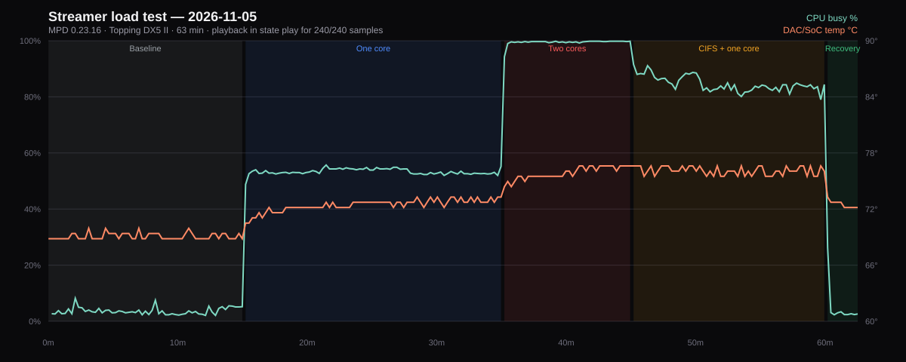

# Plinth

A native Android controller for an MPD streamer. It replaces M.A.L.P. and the
myMPD web page with two surfaces built for the way this stereo is used: a tablet
on a stand that shows what is playing, and a phone for finding something to play.

Plinth talks the MPD protocol directly over TCP and renders what the streamer
reports. It does not play audio, does not resample, and has no volume control:
the DAC has the knob, and this streamer has no mixer.

You need an MPD server on your LAN; the reference setup is the
[RT-AC88U streamer](https://github.com/andrewr8712/rt-ac88u-openwrt-streamer).
Plinth has no accounts and no TLS, so keep it on a trusted network.

## Status

Early but usable. The MPD client, the library cache, cover art, the now-playing
surface for phone and tablet, the browsing screens (library tabs, album, search,
queue, playlists, output) and the VU meter work on the reference tablet and
phone. The remaining polish is in `HANDOFF.md`.

## Screenshots

The tablet surface, at 10 inches:





The phone surface:




## Quick start

### Requirements

- An MPD server reachable over the network. Plinth sends only MPD commands; it
  never writes server configuration.
- Android 8.0 (API 26) or later.
- JDK 17 or later to build (the reference build uses JDK 21).
- Android SDK platform 35 and build-tools 35.0.0. Gradle 8.13 comes from the
  wrapper, so you don't install it separately.

The repository ships `tools/setup-android.sh`, which installs a JDK, the command
line tools, SDK packages and Gradle under `~/android-dev` without `sudo`. Run it
if you have no Android toolchain:

```bash
bash tools/setup-android.sh
export JAVA_HOME=$HOME/android-dev/jdk-21
export ANDROID_HOME=$HOME/android-dev/sdk
```

If you already have a toolchain, export your own `JAVA_HOME` and `ANDROID_HOME`
instead. Nothing is installed system-wide.

### Build and test

Build the debug APK:

```bash
./gradlew :app:assembleDebug
```

The APK lands in `app/build/outputs/apk/debug/app-debug.apk`.

Run the JVM tests, which need no device:

```bash
./gradlew :app:testDebugUnitTest
```

Run the instrumented UI tests, which need a connected device or emulator:

```bash
export ANDROID_SERIAL=DEVICE_SERIAL
./gradlew :app:connectedDebugAndroidTest
```

Replace `DEVICE_SERIAL` with the serial that `adb devices` prints.

### Install

With a device connected over USB:

```bash
./gradlew :app:assembleDebug
adb install -r app/build/outputs/apk/debug/app-debug.apk
```

For a wireless device, connect first, then install to that serial:

```bash
adb connect DEVICE_ADDRESS:PORT
adb -s DEVICE_ADDRESS:PORT install -r app/build/outputs/apk/debug/app-debug.apk
```

Replace `DEVICE_ADDRESS:PORT` with the address from `adb devices`, for example
`192.168.1.20:41219`.

### Point it at your streamer

Plinth connects to `10.0.0.219:6600` by default, the streamer it was built
against. To change it, open **Output** and tap **Change** next to the server
address, then enter your host and port and tap **Connect**. Host and port are the
only connection settings.

On first connection Plinth runs `listallinfo` and caches the result in SQLite, so
browsing, search and album art continue to work while the streamer is
unreachable.

## How it works

- Two sockets: one carries commands; the other stays parked in MPD's `idle` so
  state changes arrive without polling.
- A local cache: `listallinfo` returns about 865 KB for the reference library and
  parses in under a second, so the library is replaced wholesale rather than
  diffed.
- A queue that is refetched, never diffed: MPD's `plchanges` reports additions and
  moves but not removals, so the queue is reloaded whenever its version changes.
- Cover art on disk: `albumart` fetches one JPEG per album and caches it;
  `ACK [50@0]` means the album has no art, and that answer is cached for seven
  days.
- No invented data: every readout comes from MPD's own `status`, `stats` or the
  file's tags. A missing value renders as a dash, not a guess.

## Reliability

The reference streamer ran a 62.5-minute load test on 2026-11-05 while the
library shuffled: both Cortex-A9 cores saturated and a 2 GB CIFS read. All 240
samples were in `play`, with 0 stalls, 0 pauses or stops, and 0 MPD, USB, CIFS
or ALSA errors. Peak CPU 99.8 %, peak temperature 76.6 °C, 16 clean track
changes. The report and raw data are in the streamer repository:
[docs/STABILITY-2026-11-05.md](https://github.com/andrewr8712/rt-ac88u-openwrt-streamer/blob/main/docs/STABILITY-2026-11-05.md).



## Development

### Project layout

| Path | Contents |
|---|---|
| `app/src/main/java/dev/andrew/plinth/data/mpd/` | MPD protocol: socket transport, parser, client, idle loop, reconnect |
| `app/src/main/java/dev/andrew/plinth/data/lib/` | Room cache, library and queue repositories |
| `app/src/main/java/dev/andrew/plinth/data/art/` | Cover art fetch and disk cache |
| `app/src/main/java/dev/andrew/plinth/data/model/` | Track, album identity, player state, signal verdict |
| `app/src/main/java/dev/andrew/plinth/ui/` | Compose screens, components, view model, theme |
| `app/src/test/` | JVM tests, including a fake MPD server and fixtures from the real library |
| `app/src/androidTest/` | Instrumented UI tests |
| `tools/` | Android toolchain bootstrap |
| `mockups/` | HTML design studies, including the eleven failure states |

### Documentation

- `docs/superpowers/specs/2026-11-04-mpd-tablet-controller-design.md`: the design,
  the measurements taken from the streamer, and the rules they imply.
- `docs/superpowers/plans/2026-11-04-mpd-controller.md`: the implementation plan,
  19 tasks, with the test each task was written against.
- `HANDOFF.md`: what is built, what is left, and the pitfalls that cost real time.
- `docs/icon/README.md`: the launcher icon and how to regenerate its previews.
- `tools/vu-scan/README.md`: the loudness envelope scanner.

## License

MIT, see [LICENSE](LICENSE).
